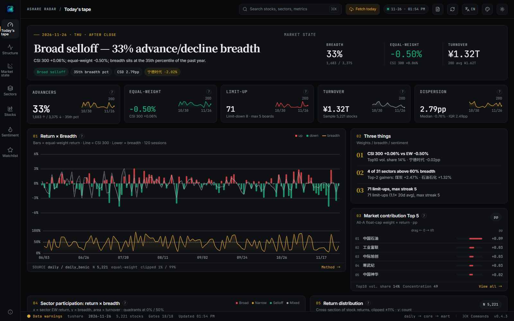

[简体中文](README.md) | **English**

<h1 align="center">Ashare Radar</h1>

<p align="center">Market breadth and structure dashboard for China A-shares</p>

<p align="center">
  <a href="https://github.com/Old-Doggy/ashare-radar/actions/workflows/ci.yml"></a>
  <a href="LICENSE"></a>
  
  
  
</p>

<p align="center">
  
</p>

Computes breadth, equal- and cap-weighted returns, concentration, sector participation and dispersion from Tushare daily data. Includes eight main screens plus briefing and chart-lab routes, a Flask API and a single-file offline export.

> **v0.4.3** fixes the P0/P1 data-integrity findings from the audit: historical partial-session backfill,
> margin aggregation scope, missing-value semantics, API security headers and deterministic ordering.
> It also adds data licence / disclaimer disclosures. See the [release notes](docs/release.md),
> [known limitations](docs/known_limitations.md) and the [historical completion report](docs/release_completion_report.md).

## Features

- Six view families: breadth, concentration, sectors, stocks, sentiment and holdings
- The Rotation view plays the sector strength cloud using each sector's last 5, 10 or 20 daily observations for cumulative equal-weight returns and average breadth
- Daily updates with 18 quality gates (14 in v0.4.2; v0.4.3 adds gates 15–18: full-history integrity, limit-band stability, sealed-amount scale and row-count trend, and fixes gates 1/3/6); current-day post-close akshare fallback
- Missing data stays unknown: rows failing coverage rules do not enter weight-based metrics and the UI shows `—`/gaps instead of 0
- Chinese/English UI, dark/light themes, colorblind palette, URL state, PNG/CSV export
- Single-file HTML build for offline use

## Quick start

Requirements: Python 3.12, Node 22.18+, a Tushare Pro token (additional endpoints require their own permissions).

### One-click start (Windows)

Double-click `start.bat`: it picks a Python with duckdb/tushare, starts the server and opens http://127.0.0.1:8000. If it is already running, it just opens the page. Double-click `stop.bat` to stop it. A missing frontend build is created with `npm install && npm run build`; if only the offline single-file build exists, the script explicitly warns that it is a non-realtime snapshot.

```bash
git clone https://github.com/Old-Doggy/ashare-radar.git
cd ashare-radar
conda create -n ashare-radar python=3.12 -y
conda activate ashare-radar
pip install -r requirements.txt
cp .env.example .env        # set TUSHARE_TOKEN
```

Build the data (pick one):

```bash
# A. Build from the Tushare API
python -m pipeline.bootstrap_api --start 20240101

# B. Use a local parquet snapshot; layout in docs/data_setup.md
python -m pipeline.bootstrap
```

```bash
python -m pipeline.build_marts
python -m backend.main      # http://127.0.0.1:8000
```

Frontend and single-file build:

```bash
cd frontend && npm ci && npm run check && cd ..
python -m pipeline.refresh_status
python -m pipeline.export_static
# open frontend/dist/ashare-radar.html
```

Use `python -m pipeline.release` for daily publication, or add `--rebuild` to rebuild only.
When upgrading from v0.3.0, build the new frontend first and run `python -m pipeline.release --rebuild` to create the rolling table and refresh the offline file.
Failed publication preserves the previous HTML. Existing offline copies cannot receive later alerts.
See the [release instructions](docs/release.md).

## Data & licence

- **Software licence**: code is released under [MIT](LICENSE).
- **Data licence**: market data comes from **Tushare Pro**. You must hold your own account, points and endpoint
  permissions and comply with Tushare's terms. This project **does not redistribute raw market data**
  (`data/`, `frontend/dist/` and `.env` are git-ignored). Screenshots are demos only; the offline HTML is
  generated locally from your own data. See [NOTICE](NOTICE).
- **Disclaimer**: this is a local analytics tool, **not investment advice**. Data may be missing, delayed or
  inconsistent with exchanges/upstream sources and is provided "as is" under MIT without warranty.
  Known issues: [docs/known_limitations.md](docs/known_limitations.md).
- Third-party components (DuckDB/Flask/React/ECharts/Tailwind/Vite/lucide, ...) keep their own licences; inlined
  fonts (Inter, JetBrains Mono, Noto Sans/Serif SC) are SIL OFL 1.1 as declared in [NOTICE](NOTICE).

## Validation status

| Item | Status (2026-11-27, after v0.4.3 integration) |
|---|---|
| Tests | pytest **236 passed / 0 failed / 0 skipped**; frontend `node --test` **117 passed / 0 fail** |
| Static checks | `ruff check` clean; `tsc --noEmit` 0 errors |
| Quality gates | **18**; 2026-11-26 `quality/latest` 18/18 pass, `blocking=[]` |
| History integrity | **192/192** partial sessions backfilled (failed=0, `remaining_partial=[]`); gate 15 passes (`incomplete_dates`=0, min daily rows 2,768) |
| Core data size | `core_stock_day` = **10,827,571** rows; `feat_stock` = 10,478,223; `mart_market_day` = 2,425 sessions (2016-12-01..2026-11-26) |
| Static audit | `scripts/audit_all.py --offline`: **60 passed / 0 failed / 3 skipped** (verdict=`pass_with_skips`; skips are not passes) |
| Artifacts | single-file HTML **63,231,201 B** (about 63.2 MB); static payload **17,624,011 B** (about 17.6 MB) |
| Payload meta | `meta.version=0.4.3`; `meta.source=tushare`; `unavailable_datasets=["limit_list_d","margin"]`; `meta.data_quality.n_partial_days=0`, `repaired_days=192` |
| Known limitations | 15 items quantified: [docs/known_limitations.md](docs/known_limitations.md) |

Integration evidence: [docs/validation/v0.4.3-final.json](docs/validation/v0.4.3-final.json).
Historical acceptance/fix reports (**historical documents**, see banners at the top):
[completion report](docs/release_completion_report.md), [fix report](docs/release_fix_report.md),
[v0.4.0 final review](docs/release_review_v0.4.0.md), [historical validation summary](docs/validation/README.md).

## Docs

| Doc | Contents |
|---|---|
| [Technical notes](docs/technical.en.md) | Architecture, screens, quality gates, concurrency, limits, roadmap |
| [Metric definitions](docs/metric_contracts.md) | Definition and denominator of each metric |
| [Known limitations](docs/known_limitations.md) | 15 quantified data facts, fix status and reproduction commands |
| [Performance](docs/performance.md) | Measurement date/env/method, first paint and API p50/p95 |
| [Data sources](docs/data_sources.md) | Primary, fallback and degradation rules |
| [Data setup](docs/data_setup.md) | Snapshot layout and bootstrap steps |
| [Data audit (historical)](docs/audit_findings.md) | Correctness checks and known biases (historical) |
| [Release notes](docs/release.md) | Versions, release checklist, tagging |
| [Decision log](docs/decisions.md) | ADR list |

## Version and licence

Current version **v0.4.3** (earlier releases in [release.md](docs/release.md)). Software under [MIT](LICENSE);
data usage and disclaimer in [NOTICE](NOTICE).
