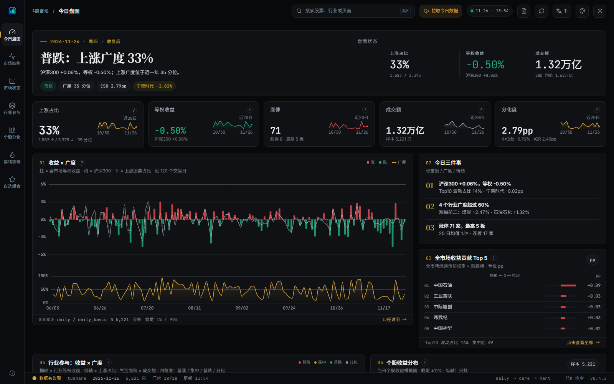

[简体中文](README.md) | [English](README.en.md)

<h1 align="center">A股雷达</h1>

<p align="center">A 股市场宽度与结构面板</p>

<p align="center">
  <a href="https://github.com/Old-Doggy/ashare-radar/actions/workflows/ci.yml"></a>
  <a href="LICENSE"></a>
  
  
  
</p>

<p align="center">
  
</p>

基于 Tushare 日频数据计算市场广度、等权/市值加权收益、集中度、行业参与和个股分化。包含 8 个主页面、每日简报与图表实验页，以及 Flask API 与单文件离线导出。

## 特性

- 广度、集中度、行业、个股、情绪、持仓六类视图
- 行业页「轮动」播放行业强度云，比较每个行业最近 5、10、20 条日度观测的累计等权收益和平均上涨占比
- 每日更新 + 18 条质量门禁（v0.4.2 为 14 条；v0.4.3 新增 gate15–18：全历史完整性、限价档稳定性、封单额量纲、行数趋势，并修正 gate1/3/6）；当日收盘后可降级到 akshare，历史补数仍需主源
- 缺失保持未知语义：门禁不足或部分交易日不参与权重类指标，前端显示 `—`/断线而不是 0
- 中英双语、深/浅主题、色盲配色、URL 状态、PNG/CSV 导出
- 支持导出单文件 HTML，离线打开

## 快速开始

要求：Python 3.12、Node 22.18+、Tushare Pro token（基础接口需 2000 积分，其他接口权限分别确认）。

### 1. 安装依赖并填写 token

```bash
git clone https://github.com/Old-Doggy/ashare-radar.git
cd ashare-radar
conda create -n ashare-radar python=3.12 -y
conda activate ashare-radar
pip install -r requirements.txt
cp .env.example .env
```

- `.env.example` 只是模板，**不要直接改它**；`cp` 出来的 **`.env`** 才是实际配置（已被 `.gitignore` 忽略）。
- 编辑 **`.env`**，填写 `TUSHARE_TOKEN=你的token`。没有 token 只能查看现成的离线快照，不能拉取/更新数据。

### 2. 构建数据（首次从零建库时执行）

数据分两步：先拉原始行情，再算页面用的分析表。

```bash
# 2a. 原始行情 → data/lake.duckdb（二选一）
python -m pipeline.bootstrap_api --start 20240101   # A. 直接调用 Tushare API
python -m pipeline.bootstrap                          # B. 用本地 parquet 快照（目录结构见 docs/data_setup.md）

# 2b. 原始行情 → 分析表（必须执行一次）
python -m pipeline.build_marts
```

- `bootstrap_api` / `bootstrap`：只写入 core 原始表（daily、daily_basic、adj_factor、stk_limit、指数、资金流、两融等）。`--start` 是起始日期：`20240101` 约 1 年、几分钟量级；更长历史（如 `20160101`，约 2,650 个交易日）约 **35–45 分钟**（默认 3 并发取数 + 450 次/分钟限速，`--workers` 可调）；中断后重跑同一命令会从检查点续跑。
- `build_marts`：把原始表算成 `feat_stock`、`mart_market_day`、行业/轮动/月表等分析表，**建库后必须跑一次，否则页面没有数据**。如果拿到的是别人构建好的 `data/lake.duckdb`（已含 marts），本步可跳过。
- 两步都需要 token；`limit_list_d` 等可选接口无权限时会自动跳过并告警（对应指标显示为 `—`，不显示错误数字）。
- 请求自动限速：5000 积分常规接口 500 次/分钟，但 `limit_list_d` 是 200 次/分钟 + 1 万次/天、`stock_basic` 是 50 次/分钟；本项目默认留 20%–40% 余量，限频错误自动指数退避，无权限接口只试一次就跳过，**中断后重跑同一条命令会续跑**。详见 [docs/rate_limits.md](docs/rate_limits.md)。

> **命令立刻回到提示符、没有任何输出/进度？**
> 通常不是程序卡住，而是 `python` 不是装了依赖的那个解释器（Windows 上 `python` 常指向应用商店占位程序或另一个 Python，命令会静默退出）。先自检：
>
> ```bash
> where.exe python
> python -c "import sys, duckdb, tushare, flask; print(sys.executable, 'deps ok')"
> ```
>
> 不成功就先 `conda activate ashare-radar`；或直接用项目自带的解释器选择器：`powershell -NoProfile -ExecutionPolicy Bypass -File scripts\python.ps1` 会打印一个可用的 python 路径，再执行 `& "该路径" -u -m pipeline.bootstrap_api --start 20240101`。
>
> 另外建议加 `-u` 让输出不缓冲；长区间放后台并记日志：`python -u -m pipeline.bootstrap_api --start 20160101 *> bootstrap.log`，再开一个窗口 `Get-Content bootstrap.log -Wait -Tail 20` 看进度。

### 3. 启动看板（二选一）

**方式一（Windows 推荐）：双击 `start.bat`**
自动选择带依赖的 Python；`frontend/dist` 未构建时自动执行 `npm install && npm run build`；后台启动服务并在浏览器打开 <http://127.0.0.1:8000>；服务已在运行则直接打开。停止双击 `stop.bat`。
它只负责“构建前端 + 启动服务”，**不会建库**：缺少 `data/lake.duckdb` 时只会提示先完成第 2 步。

**方式二（手动）：**

```bash
cd frontend && npm ci && npm run build && cd ..   # 首次需要；前端不改可跳过
python -m backend.main                            # 前台启动服务，Ctrl+C 停止
```

- `backend.main`：启动 Flask 服务，同时提供 `/api/*` 接口和已构建的前端页面，浏览器打开 <http://127.0.0.1:8000>；前端未构建时只返回 API、不显示页面。

> 如果工作区已经带有 `data/lake.duckdb` 和 `frontend/dist`（例如本机开发目录），**直接双击 `start.bat` 即可**，无需再做第 2 步。

### 4. 每日更新与离线单文件

```bash
python -m pipeline.release    # 拉取最新交易日 → 18 条质量门禁 → 重算 marts → 导出离线 HTML
```

- 只重建不拉数据：`python -m pipeline.release --rebuild`；只导出离线包：`python -m pipeline.export_static`。
- 离线单文件在 `frontend/dist/ashare-radar.html`，双击即可打开；它是导出时的快照，不需要服务也不实时。
- 更新任务、API 按钮和 Windows 脚本共用同一发布链；失败会保留上一版 HTML，已打开的离线包不会自动收到新告警。详见[发布说明](docs/release.md)。

## 数据与许可

- **软件许可**：代码以 [MIT](LICENSE) 发布。
- **数据许可**：行情数据来自 **Tushare Pro**，使用者必须自行持有账号与接口权限，并遵守其服务条款；
  本项目**不再分发任何原始行情数据**（`data/`、`frontend/dist/`、`.env` 均不入库）。
  仓库内截图仅为功能演示；离线单文件 HTML 由使用者自行用本地数据生成。详见 [NOTICE](NOTICE)。
- **免责声明**：本项目是本地分析工具，**不构成投资建议**；数据可能缺失、延迟或与交易所/上游不一致，
  按 MIT「as is」提供，不对准确性作担保。已知问题见 [docs/known_limitations.md](docs/known_limitations.md)。
- 第三方组件（DuckDB/Flask/React/ECharts/Tailwind/Vite/lucide 等）保留各自许可；
  内联字体（Inter、JetBrains Mono、Noto Sans/Serif SC）为 SIL OFL 1.1，声明见 [NOTICE](NOTICE)。

## 文档

| 文档 | 内容 |
|---|---|
| [技术说明](docs/technical.md) | 架构、页面、质量门禁、并发、限制、Roadmap |
| [指标口径](docs/metric_contracts.md) | 每个指标的定义与分母 |
| [已知限制](docs/known_limitations.md) | 15 条数据事实、修复状态与复现命令 |
| [性能实测](docs/performance.md) | 测量时间/环境/方法、首屏与 API p50/p95 |
| [数据源](docs/data_sources.md) | 主源、备用源、降级规则、许可限制 |
| [Tushare 限频](docs/rate_limits.md) | 官方频次限制、默认节流参数、限频退避与配额说明 |
| [数据准备](docs/data_setup.md) | 快照目录结构与建库步骤 |
| [数据审计（历史）](docs/audit_findings.md) | 正确性验证与已知偏差（历史记录） |
| [发布说明](docs/release.md) | 版本、发布检查清单、tag 流程 |
| [决策记录](docs/decisions.md) | ADR 列表 |

## 版本与许可

当前版本 **v0.4.3**（v0.4.2 之前的发布记录见 [release.md](docs/release.md)）。软件许可 [MIT](LICENSE)；
数据使用与免责声明见 [NOTICE](NOTICE)。
